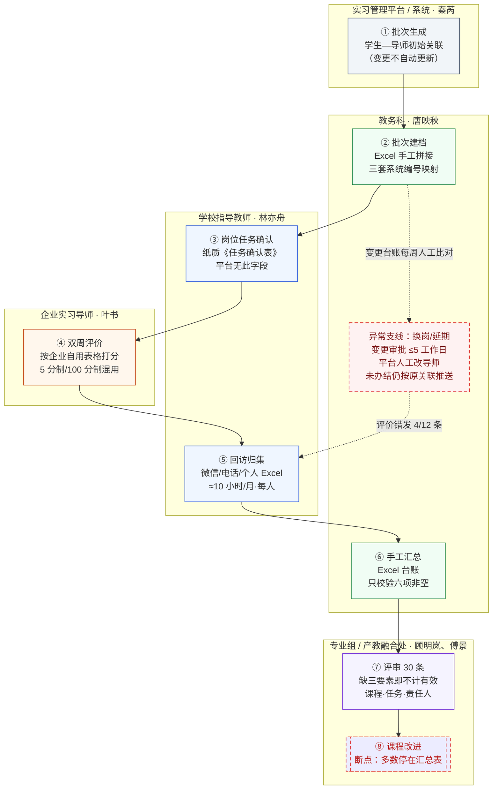

# 现状流程图 · 知行职业学院实习反馈与教学改进（As-Is）

**阶段**：01 业务挖掘　**日期**：2026-11-05
**配套文件**：`04-现状流程图.svg`（矢量，可放大/打印）、`04-现状流程图.html`（含环节说明表，可直接打印）、`04-现状流程图.png`（位图，可直接贴入 Word/PPT）
**依据**：36 条访谈事实（教育-001～036）+ 4 份原有资料（ZL-01～ZL-04）｜合成训练案例

> **读法**：横轴自左向右为业务发生的先后顺序，纵轴为承担该环节的角色；灰实线为主流程，红色虚线为异常回流路径。⑧「课程改进」为红色虚线框并标注**断点**——多数建议止步于此。

---

## 一、Mermaid 源码（可粘贴到支持 Mermaid 的编辑器直接渲染）

## 二、环节说明与现状问题

| # | 环节 | 执行角色 | 载体 / 工具 | 频次 | 现状问题（证据） |
| --- | --- | --- | --- | --- | --- |
| ① | 批次生成 | 实习平台 | 平台批次表 | 学期初 | 学生—导师关联为初始值，换岗后不自动更新（教育-005、ZL-04 D-1） |
| ② | 批次建档 | 教务科（唐映秋） | 平台 + Excel 映射表 | 学期初 | **学籍号 / 实习编号 / 课程 ID 三套编号不通用，映射表人工拼接**（教育-010） |
| ③ | 岗位任务确认 | 学校 + 企业导师 | 纸质《岗位任务确认表》 | 到岗 5 日内 | **平台无「岗位任务」字段，任务清单未结构化，评价无法定位教学环节**（教育-011、ZL-04 D-3） |
| ④ | 双周评价 | 企业导师（叶书） | 在线评价表（ZL-02） | 每两周 ×10 | **5 分制与 100 分制并存、无换算备案；评语仅校验非空**（教育-008、教育-004） |
| ⑤ | 回访归集 | 学校导师（林亦舟） | 微信 / 电话 / 个人 Excel | 每周 | **关键事实留在系统外**；约 10 小时/月·每人，属二次劳动（教育-006、教育-023） |
| ⑥ | 手工汇总 | 教务科（唐映秋） | Excel 台账（ZL-03） | 学期末 | **只校验六项非空，「完整」≠「可用」；分母按学期而非双周批次**（教育-034、ZL-03 §5） |
| ⑦ | 评审 30 条 | 专业组 / 傅景 | 评审会 + 建议表 | 学期末 | **建议缺「课程·任务·责任人」三要素即不计有效，历史无基线**（教育-015） |
| ⑧ | 课程改进 | 专业组 / 顾明岚 | 培养方案 / 教学计划 | 下学期 | **断点：多数建议停在汇总表，未落到具体课程**（教育-001、教育-002） |
| 异常 | 换岗/延期 → 错发 | 教务科 + 平台 | 变更审批 + 平台变更页 | 按需 | **12 条变更中 5 条导师未同步（41.7%），4 条造成错发；办结最长 9 个工作日**（教育-005、教育-025、ZL-01 第十二条） |

## 三、图上数据标注

| 标注 | 数值 | 口径说明 |
| --- | --- | --- |
| 反馈完整率 | 54% | 六项非空口径（台账），**非可用率**；机电专业 64/120 = 53.3% |
| 教师整理工时 | ≈10 小时/月/人 | 口述流程口径，未抽样验证（教育-006） |
| 评分制 | 3/5 家企业五分制 | 均未提交百分制换算依据（教育-008、ZL-03 §2） |
| 错发 | 4/12 条 | 2026 春季换岗/延期变更登记（ZL-03 §4） |
| 评审标准 | 30 条中 ≥24 条 | 须对应课程·任务·责任人三要素（教育-015），历史无基线 |

## 四、与机会点的对应

| 图上位置 | 对应机会（见《业务挖掘-三项任务》） | 改造后应达到的状态 |
| --- | --- | --- |
| ③ 岗位任务确认 | O1 反馈归位 | 任务清单结构化进采集表，评价可定位教学环节 |
| ④ 双周评价 + 异常支线 | O2 变更同步与错发阻断 | 变更事件同步导师关联，错发 = 0 |
| ⑥ 手工汇总 + ⑦ 评审 | O3 建议到课程闭环 | 建议强制三要素，24/30 计有效 |
| ② 建档 + ④ 评分制 | O4 口径对齐 | 分母按双周批次固定；五分制换算备案 |

---

*本图为合成训练案例材料，非真实客户流程；对外引用前须由发起人书面确认范围与用途。*
